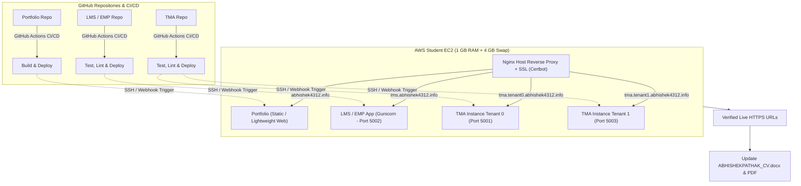

# Comprehensive Master Plan: 3-Project CI/CD, AWS Student VPS Hosting, & CV Elevation

> [!IMPORTANT]
> **Plan-Only Mode Active:** No code, files, or infrastructure will be created, modified, or deployed until you review, customize, and explicitly approve this plan.

---

## High-Level Architecture Overview



---

## Phase 1: Portfolio Code Cleaning & Modernization

You will provide your local portfolio codebase and guidelines on how you want it styled and structured.

1. **Intake & Review:**
   - Ingest your local portfolio files.
   - You provide your prompt/instructions on layout, sections, theme, and styling.
2. **Refactoring & Polish:**
   - Clean up HTML/CSS/JavaScript structure.
   - Make it fully responsive across mobile, tablet, and desktop.
   - Include dedicated showcase cards for:
     - **TMA (Trekking Management Application)** with tenant links.
     - **LMS (Examination Management Portal)**.
     - Direct links to GitHub repositories, live demos, and pre-seeded demo accounts.
3. **Repository Setup:**
   - Initialize clean Git repository, commit with semantic versioning, and push to GitHub (`raj4312/portfolio`).

---

## Phase 2: Upgrading All 3 Repositories to Dev-Grade Standards & CI/CD

Before deploying to the cloud, each repository must meet professional industry standards with automated CI/CD pipelines.

### 1. Portfolio Repository:
* **CI Workflow (`.github/workflows/ci.yml`):**
  * HTML/CSS validation and linter.
  * Link checker to prevent dead hyperlinks.
* **CD Workflow (`.github/workflows/deploy.yml`):**
  * Automated rsync or container deployment to AWS EC2 on push to `main`.

### 2. LMS / EMP Repository (`mad`):
* **Code Standardization:**
  * Clean dependency locks (`requirements.txt`).
  * Ensure Gunicorn WSGI configuration and production `.env.example` are pristine.
* **CI Workflow (`.github/workflows/ci.yml`):**
  * Set up Python matrix (3.11 / 3.12).
  * Run **Ruff / Flake8** linting and code formatting checks.
  * Execute **Pytest** test suite with coverage thresholds.
  * Build Docker image to verify container integrity.
* **CD Workflow (`.github/workflows/deploy.yml`):**
  * Triggers on `main` merge after CI passes.
  * Connects to AWS via SSH, executes `docker compose pull`, database migrations (`flask db upgrade` / `init-db`), and zero-downtime container restart.

### 3. TMA Repository (`mad1`):
* **Multi-Tenant Architecture Setup:**
  * Configure environment variables and database isolation for multiple tenants:
    * **Tenant 0:** `tma.tenant0.<domain>` (e.g. Himalayas Expedition Club)
    * **Tenant 1:** `tma.tenant1.<domain>` (e.g. Western Ghats Adventure Club)
  * Supports either database-level schema separation or containerized instance per tenant.
* **CI Workflow (`.github/workflows/ci.yml`):**
  * Linting with Flake8/Black.
  * Pytest test suite with code coverage.
  * Multi-container compose build verification (`web`, `test`, `postgres`).
* **CD Workflow (`.github/workflows/deploy.yml`):**
  * Deploys and manages both tenant containers with persistent PostgreSQL volumes.

---

## Phase 3: AWS Student VPS (1 GB EC2) Setup & Optimization

> [!WARNING]
> **The 1 GB RAM Challenge:** Running 3 full applications plus Nginx and background services on an AWS student instance (1 GB RAM `t2.micro` or `t3.micro`) will cause immediate Out-Of-Memory (OOM) kernel crashes unless carefully configured.

### Step-by-Step Server Setup:
1. **EC2 Provisioning:**
   * Launch Ubuntu 24.04 LTS `t2.micro` or `t3.micro` via AWS Student / Educate / Free Tier.
   * Attach an Elastic IP (so your public IP remains static).
   * Configure AWS Security Group:
     * Inbound: Port 22 (SSH), Port 80 (HTTP), Port 443 (HTTPS).
2. **Swapfile Configuration (Mandatory):**
   * Allocate **4 GB Swap** to prevent OOM kills:
     ```bash
     sudo fallocate -l 4G /swapfile
     sudo chmod 600 /swapfile
     sudo mkswap /swapfile
     sudo swapon /swapfile
     echo '/swapfile none swap sw 0 0' | sudo tee -a /etc/fstab
     sudo sysctl vm.swappiness=10
     ```
3. **Low-Memory Service Tuning:**
   * Run Gunicorn with 1 to 2 workers max per app (`-w 1 --threads 2`) to cap RAM usage.
   * Restrict Docker memory ceilings per container (e.g., `mem_limit: 250m`).
4. **Install Base Packages:**
   * Docker Engine, Docker Compose plugin, Nginx, Certbot (`python3-certbot-nginx`), Git.

---

## Phase 4: Subdomains, Nginx Reverse Proxy & SSL

All projects will resolve under your primary URL using clean, isolated subdomains:

| Subdomain | Target Application | Internal Port | SSL Status |
| :--- | :--- | :--- | :--- |
| **`abhishek4312.info`** (or `www`) | Personal Portfolio Website | Static / Local Port 8080 | Let's Encrypt HTTPS |
| **`lms.abhishek4312.info`** | Examination Management Portal | Gunicorn 127.0.0.1:5002 | Let's Encrypt HTTPS |
| **`tma.tenant0.abhishek4312.info`** | TMA - Tenant 0 Instance | Gunicorn 127.0.0.1:5001 | Let's Encrypt HTTPS |
| **`tma.tenant1.abhishek4312.info`** | TMA - Tenant 1 Instance | Gunicorn 127.0.0.1:5003 | Let's Encrypt HTTPS |

### Steps:
1. **DNS Records (Registrar Dashboard):**
   * `A` record `@` &rarr; `<AWS_Elastic_IP>`
   * `A` record `lms` &rarr; `<AWS_Elastic_IP>`
   * `A` record `tma.tenant0` &rarr; `<AWS_Elastic_IP>`
   * `A` record `tma.tenant1` &rarr; `<AWS_Elastic_IP>`
2. **Nginx Virtual Hosts:**
   * Create modular configs in `/etc/nginx/sites-available/` with proxy buffering and security headers.
3. **Automated SSL Certificates:**
   * Execute Certbot to issue HTTPS certificates for all subdomains with auto-renewal timers enabled.

---

## Phase 5: Demo Data Seeding & Zero-Friction Recruiter Access

Recruiters must be able to explore the applications without running into blank screens or blocked signups:
1. **LMS Demo Data:**
   * Admin account, Examiner account, Student account.
   * Pre-scheduled viva slots, active test questions, and student grade records.
2. **TMA Tenant 0 & Tenant 1 Data:**
   * Distinct branding/treks for each tenant to showcase multi-tenancy.
   * Admin credentials and sample trek bookings.
3. **One-Click Demo Banner:**
   * Add a top banner with credentials: `"Demo Login: examiner@demo.com | Pass: Demo@123"` so any reviewer can immediately test the platform.

---

## Phase 6: CV Revamp & Final Polish

Once all links are live, tested, and green in CI/CD:
1. Update [ABHISHEKPATHAK_CV.docx](file:///c:/Users/ACER/Desktop/FORM/ABHISHEKPATHAK_CV.docx):
   * Add the 3 projects with verified **Live Demo URLs** and **GitHub links**.
   * Replace beginner wording with professional industry bullet points (CI/CD, multi-tenancy, Docker, REST APIs, Chart.js, RBAC).
   * Upgrade the Technical Skills section.
   * Fix formatting, alignment, and spelling errors.
2. Export the final polished [ABHISHEKPATHAK_CV.pdf](file:///c:/Users/ACER/Desktop/FORM/ABHISHEKPATHAK_CV.pdf).
