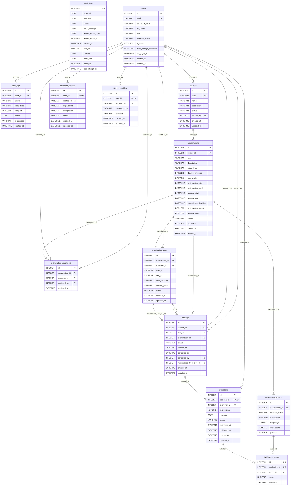

# System Facts and Architecture

*Generated on 2026-11-18 12:09:34 UTC*

## 1. Libraries and Dependencies

| Package | Version | Tier | Purpose | Licence |
| :--- | :--- | :--- | :--- | :--- |
| email-validator | 2.2.0 | 1 | Email address format validation | Unlicense |
| Flask | 3.0.3 | 1 | Web framework and routing core |  |
| Flask-SQLAlchemy | 3.1.1 | 1 | SQLAlchemy ORM integration and session management |  |
| Flask-WTF | 1.2.1 | 1 | Form handling and CSRF protection | Copyright 2010 WTForms

Redistribution and use in source and binary forms, with or without
modification, are permitted provided that the following conditions are
met:

1.  Redistributions of source code must retain the above copyright
    notice, this list of conditions and the following disclaimer.

2.  Redistributions in binary form must reproduce the above copyright
    notice, this list of conditions and the following disclaimer in the
    documentation and/or other materials provided with the distribution.

3.  Neither the name of the copyright holder nor the names of its
    contributors may be used to endorse or promote products derived from
    this software without specific prior written permission.

THIS SOFTWARE IS PROVIDED BY THE COPYRIGHT HOLDERS AND CONTRIBUTORS
"AS IS" AND ANY EXPRESS OR IMPLIED WARRANTIES, INCLUDING, BUT NOT
LIMITED TO, THE IMPLIED WARRANTIES OF MERCHANTABILITY AND FITNESS FOR A
PARTICULAR PURPOSE ARE DISCLAIMED. IN NO EVENT SHALL THE COPYRIGHT
HOLDER OR CONTRIBUTORS BE LIABLE FOR ANY DIRECT, INDIRECT, INCIDENTAL,
SPECIAL, EXEMPLARY, OR CONSEQUENTIAL DAMAGES (INCLUDING, BUT NOT LIMITED
TO, PROCUREMENT OF SUBSTITUTE GOODS OR SERVICES; LOSS OF USE, DATA, OR
PROFITS; OR BUSINESS INTERRUPTION) HOWEVER CAUSED AND ON ANY THEORY OF
LIABILITY, WHETHER IN CONTRACT, STRICT LIABILITY, OR TORT (INCLUDING
NEGLIGENCE OR OTHERWISE) ARISING IN ANY WAY OUT OF THE USE OF THIS
SOFTWARE, EVEN IF ADVISED OF THE POSSIBILITY OF SUCH DAMAGE. |
| python_dotenv | 1.0.1 | 1 | see documentation | BSD-3-Clause |
| SQLAlchemy | 2.0.36 | 1 | Database abstraction and ORM | MIT |
| Werkzeug | 3.0.4 | 1 | WSGI utilities and password hashing |  |
| WTForms | 3.2.1 | 1 | Form validation and rendering engine | Copyright 2008 WTForms

Redistribution and use in source and binary forms, with or without
modification, are permitted provided that the following conditions are
met:

1.  Redistributions of source code must retain the above copyright
    notice, this list of conditions and the following disclaimer.

2.  Redistributions in binary form must reproduce the above copyright
    notice, this list of conditions and the following disclaimer in the
    documentation and/or other materials provided with the distribution.

3.  Neither the name of the copyright holder nor the names of its
    contributors may be used to endorse or promote products derived from
    this software without specific prior written permission.

THIS SOFTWARE IS PROVIDED BY THE COPYRIGHT HOLDERS AND CONTRIBUTORS
"AS IS" AND ANY EXPRESS OR IMPLIED WARRANTIES, INCLUDING, BUT NOT
LIMITED TO, THE IMPLIED WARRANTIES OF MERCHANTABILITY AND FITNESS FOR A
PARTICULAR PURPOSE ARE DISCLAIMED. IN NO EVENT SHALL THE COPYRIGHT
HOLDER OR CONTRIBUTORS BE LIABLE FOR ANY DIRECT, INDIRECT, INCIDENTAL,
SPECIAL, EXEMPLARY, OR CONSEQUENTIAL DAMAGES (INCLUDING, BUT NOT LIMITED
TO, PROCUREMENT OF SUBSTITUTE GOODS OR SERVICES; LOSS OF USE, DATA, OR
PROFITS; OR BUSINESS INTERRUPTION) HOWEVER CAUSED AND ON ANY THEORY OF
LIABILITY, WHETHER IN CONTRACT, STRICT LIABILITY, OR TORT (INCLUDING
NEGLIGENCE OR OTHERWISE) ARISING IN ANY WAY OUT OF THE USE OF THIS
SOFTWARE, EVEN IF ADVISED OF THE POSSIBILITY OF SUCH DAMAGE. |
| Flask-Login | 0.6.3 | 2 | User session management and authentication | MIT |
| Flask-Mail | 0.10.0 | 2 | SMTP transactional email integration |  |
| reportlab | 4.1.0 | 2 | PDF scorecard document generation | BSD license (see license.txt for details), Copyright (c) 2000-2022, ReportLab Inc. |
| aiosmtpd | 1.4.6 | dev | In-process SMTP test server sink | Apache-2.0 |
| black | 24.10.0 | dev | Deterministic code formatter | MIT |
| playwright | 1.48.0 | dev | End-to-end browser automation | Apache-2.0 |
| pypdf | 4.0.1 | dev | PDF text extraction for verification tests |  |
| pytest | 8.3.3 | dev | Unit and integration test runner | MIT |
| pytest-cov | 6.0.0 | dev | Test coverage reporting | MIT |
| ruff | 0.7.2 | dev | Fast Python linter | MIT |

## 2. Endpoints

### Tier 1 HTML Routes

| Method | Path | Endpoint | Blueprint | Summary |
| :--- | :--- | :--- | :--- | :--- |
| GET | / | auth.index | auth | Root URL router: Redirect authenticated users to their dashboard, else to login. |
| GET | /account-inactive | auth.account_inactive | auth | Notice page for deactivated accounts (PUB-04). |
| GET | /admin/bookings | admin.bookings | admin | List all student bookings with status filters (ADM-15). |
| GET | /admin/bookings | admin.bookings_list | admin | List all student bookings with status filters (ADM-15). |
| GET | /admin/bookings/<int:booking_id> | admin.booking_detail | admin | View booking reservation details (read-only in P3). |
| POST | /admin/bookings/<int:booking_id>/cancel | admin.admin_cancel_booking | admin |  |
| GET | /admin/bookings/<int:booking_id>/reschedule | admin.reschedule_booking | admin |  |
| POST | /admin/bookings/<int:booking_id>/reschedule | admin.reschedule_booking | admin |  |
| GET | /admin/charts | admin.charts | admin |  |
| GET | /admin/courses | admin.courses | admin | List all courses with pagination and status filter (ADM-02). |
| GET | /admin/courses | admin.courses_list | admin | List all courses with pagination and status filter (ADM-02). |
| POST | /admin/courses | admin.create_course | admin | Handle course creation POST. |
| POST | /admin/courses/<int:course_id>/delete | admin.delete_course | admin | Handle course delete via ConfirmForm. |
| GET | /admin/courses/<int:course_id>/edit | admin.edit_course | admin | Display course edit form. |
| POST | /admin/courses/<int:course_id>/update | admin.update_course | admin | Handle course update POST. |
| GET | /admin/courses/new | admin.new_course | admin | Display empty course creation form (ADM-03). |
| GET | /admin/dashboard | admin.dashboard | admin | Display the 6 main metrics and recent activity. |
| GET | /admin/evaluations | admin.evaluations_list | admin |  |
| POST | /admin/evaluations/<int:evaluation_id>/publish | admin.admin_publish_evaluation | admin |  |
| GET | /admin/examinations | admin.examinations | admin | List examinations with filters (ADM-04). |
| GET | /admin/examinations | admin.examinations_list | admin | List examinations with filters (ADM-04). |
| POST | /admin/examinations | admin.create_examination | admin | Handle examination creation POST. |
| GET | /admin/examinations/<int:exam_id> | admin.examination_detail | admin | Examination detail view with timeline switches and rubrics (ADM-06). |
| POST | /admin/examinations/<int:exam_id>/booking/toggle | admin.toggle_booking | admin | Toggle student booking switch. |
| POST | /admin/examinations/<int:exam_id>/delete | admin.delete_examination | admin | Handle examination soft-deletion. |
| GET | /admin/examinations/<int:exam_id>/edit | admin.edit_examination | admin | Render examination edit form. |
| POST | /admin/examinations/<int:exam_id>/examiners | admin.assign_examiner | admin | Assign an examiner to an examination. |
| POST | /admin/examinations/<int:exam_id>/examiners/<int:examiner_id>/remove | admin.remove_examiner | admin | Remove assigned examiner from an examination. |
| GET | /admin/examinations/<int:exam_id>/rubrics | admin.rubrics | admin | List rubrics for an examination and show add form (ADM-07). |
| POST | /admin/examinations/<int:exam_id>/rubrics | admin.add_rubric | admin | Add a rubric criterion to an examination. |
| POST | /admin/examinations/<int:exam_id>/rubrics/<int:rubric_id>/delete | admin.delete_rubric | admin | Delete a rubric criterion. |
| POST | /admin/examinations/<int:exam_id>/slot-creation/toggle | admin.toggle_slot_creation | admin | Toggle slot creation switch. |
| POST | /admin/examinations/<int:exam_id>/update | admin.update_examination | admin | Handle examination update POST. |
| GET | /admin/examinations/new | admin.new_examination | admin | Render empty examination creation form (ADM-05). |
| GET | /admin/examiners | admin.examiners | admin | List examiners with status filter (ADM-09). |
| GET | /admin/examiners | admin.examiners_list | admin | List examiners with status filter (ADM-09). |
| GET | /admin/examiners/<int:examiner_id> | admin.examiner_detail | admin | View examiner profile, slots, and audit history (ADM-10). |
| POST | /admin/examiners/<int:examiner_id>/activate | admin.activate_examiner | admin | Activate an inactive examiner. |
| POST | /admin/examiners/<int:examiner_id>/approve | admin.approve_examiner | admin | Approve a pending examiner. |
| POST | /admin/examiners/<int:examiner_id>/deactivate | admin.deactivate_examiner | admin | Deactivate an active examiner. |
| POST | /admin/examiners/<int:examiner_id>/reject | admin.reject_examiner | admin | Reject a pending examiner registration. |
| GET | /admin/examiners/new | admin.new_examiner | admin | Directly create an approved examiner account. |
| POST | /admin/examiners/new | admin.new_examiner | admin | Directly create an approved examiner account. |
| GET | /admin/history | admin.history | admin | Browse historical examinations, bookings, evaluations, and audit logs. |
| GET | /admin/search | admin.search | admin | Multi-entity administrative search. |
| GET | /admin/slots | admin.slots | admin | List all scheduled examination slots with filters (ADM-13). |
| GET | /admin/slots | admin.slots_list | admin | List all scheduled examination slots with filters (ADM-13). |
| GET | /admin/slots/<int:slot_id> | admin.slot_detail | admin | View slot details and booked students. |
| GET | /admin/slots/<int:slot_id>/examiner | admin.change_slot_examiner | admin | Change the assigned examiner for a slot (ADM-14). |
| POST | /admin/slots/<int:slot_id>/examiner | admin.change_slot_examiner | admin | Change the assigned examiner for a slot (ADM-14). |
| GET | /admin/students | admin.students | admin | List students with search filter (ADM-11). |
| GET | /admin/students | admin.students_list | admin | List students with search filter (ADM-11). |
| GET | /admin/students/<int:student_id> | admin.student_detail | admin | View student profile, booking history, and audit records (ADM-12). |
| POST | /admin/users/<int:user_id>/temporary-password | admin.set_temporary_password | admin | Generate or set a temporary password for an examiner or student. |
| GET | /blocked-response | auth.blocked_response | auth |  |
| GET | /change-password | auth.change_password | auth | Change password view for first-login reset or voluntary change (PUB-05). |
| POST | /change-password | auth.change_password | auth | Change password view for first-login reset or voluntary change (PUB-05). |
| GET | /examiner/bookings/<int:booking_id>/evaluate | examiner.evaluate_booking | examiner |  |
| POST | /examiner/bookings/<int:booking_id>/evaluate | examiner.evaluate_booking | examiner |  |
| GET | /examiner/charts | examiner.charts | examiner |  |
| GET | /examiner/dashboard | examiner.dashboard | examiner |  |
| GET | /examiner/evaluations | examiner.evaluations_pending | examiner |  |
| GET | /examiner/evaluations/submitted | examiner.evaluations_submitted | examiner |  |
| GET | /examiner/examinations | examiner.examinations_list | examiner |  |
| GET | /examiner/examinations/<int:exam_id> | examiner.examination_detail | examiner |  |
| GET | /examiner/slots | examiner.slots_list | examiner |  |
| POST | /examiner/slots/<int:slot_id>/cancel | examiner.cancel_slot_action | examiner |  |
| POST | /examiner/slots/<int:slot_id>/delete | examiner.slot_delete | examiner |  |
| GET | /examiner/slots/<int:slot_id>/edit | examiner.slot_edit | examiner |  |
| POST | /examiner/slots/<int:slot_id>/edit | examiner.slot_edit | examiner |  |
| GET | /examiner/slots/<int:slot_id>/students | examiner.slot_students | examiner |  |
| POST | /examiner/slots/<int:slot_id>/update | examiner.slot_update | examiner |  |
| GET | /examiner/slots/new | examiner.slot_create | examiner |  |
| POST | /examiner/slots/new | examiner.slot_create | examiner |  |
| GET | /login | auth.login | auth | User login endpoint (PUB-01). |
| POST | /login | auth.login | auth | User login endpoint (PUB-01). |
| POST | /logout | auth.logout | auth | POST-only logout endpoint with CSRF protection. |
| GET | /pending-approval | auth.pending_approval | auth | Notice page for unapproved or rejected examiners (PUB-03). |
| GET | /profile | auth.profile | auth | View and update profile information for the authenticated user. |
| POST | /profile | auth.profile | auth | View and update profile information for the authenticated user. |
| GET | /register | auth.register | auth | User registration for Students and Examiners (PUB-02). |
| POST | /register | auth.register | auth | User registration for Students and Examiners (PUB-02). |
| GET | /student/bookings | student.my_bookings_list | student |  |
| GET | /student/bookings | student.bookings | student |  |
| GET | /student/bookings/<int:booking_id> | student.booking_detail | student |  |
| POST | /student/bookings/<int:booking_id>/cancel | student.cancel_booking_action | student |  |
| GET | /student/bookings/<int:id>/scorecard.pdf | student.download_scorecard | student |  |
| GET | /student/charts | student.charts | student |  |
| GET | /student/dashboard | student.dashboard | student |  |
| GET | /student/examinations | student.examinations_list | student |  |
| GET | /student/examinations | student.examinations | student |  |
| GET | /student/examinations/<int:exam_id> | student.examination_detail | student |  |
| GET | /student/history | student.history_view | student |  |
| GET | /student/results | student.results_list | student |  |
| GET | /student/results | student.results | student |  |
| GET | /student/results/<int:booking_id> | student.result_detail | student |  |
| GET | /student/schedule | student.schedule_view | student |  |
| POST | /student/slots/<int:slot_id>/book | student.book_slot_action | student |  |

### Tier 2 API Routes

| Method | Path | Endpoint | Blueprint | Summary |
| :--- | :--- | :--- | :--- | :--- |
| GET | /api/v1/bookings | api_v1.list_bookings | api_v1 |  |
| POST | /api/v1/bookings | api_v1.create_booking | api_v1 |  |
| DELETE | /api/v1/bookings/<int:booking_id> | api_v1.cancel_booking | api_v1 |  |
| GET | /api/v1/bookings/<int:booking_id> | api_v1.get_booking | api_v1 |  |
| GET | /api/v1/charts/booking-status | api_v1.chart_booking_status | api_v1 |  |
| GET | /api/v1/charts/bookings-by-day | api_v1.chart_bookings_by_day | api_v1 |  |
| GET | /api/v1/charts/examination-completion | api_v1.chart_examination_completion | api_v1 |  |
| GET | /api/v1/charts/examiner-workload | api_v1.chart_examiner_workload | api_v1 |  |
| GET | /api/v1/charts/participants-by-slot | api_v1.chart_participants_by_slot | api_v1 |  |
| GET | /api/v1/charts/results | api_v1.chart_results | api_v1 |  |
| GET | /api/v1/docs | api_v1.docs | api_v1 |  |
| GET | /api/v1/docs | api_v1.api_docs | api_v1 |  |
| GET | /api/v1/examinations | api_v1.list_examinations | api_v1 |  |
| POST | /api/v1/examinations | api_v1.create_examination | api_v1 |  |
| DELETE | /api/v1/examinations/<int:exam_id> | api_v1.delete_examination | api_v1 |  |
| GET | /api/v1/examinations/<int:exam_id> | api_v1.get_examination | api_v1 |  |
| PUT | /api/v1/examinations/<int:exam_id> | api_v1.update_examination | api_v1 |  |
| GET | /api/v1/examiners | api_v1.list_examiners | api_v1 |  |
| GET | /api/v1/session | api_v1.get_session | api_v1 |  |
| GET | /api/v1/slots | api_v1.list_slots | api_v1 |  |
| POST | /api/v1/slots | api_v1.create_slot | api_v1 |  |
| DELETE | /api/v1/slots/<int:slot_id> | api_v1.delete_slot | api_v1 |  |
| GET | /api/v1/slots/<int:slot_id> | api_v1.get_slot | api_v1 |  |
| PUT | /api/v1/slots/<int:slot_id> | api_v1.update_slot | api_v1 |  |
| GET | /api/v1/stats/summary | api_v1.stats_summary | api_v1 |  |
| GET | /api/v1/students | api_v1.list_students | api_v1 |  |

## 3. Entity-Relationship Diagram

Total tables: 13

